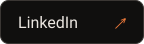
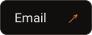
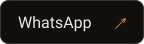
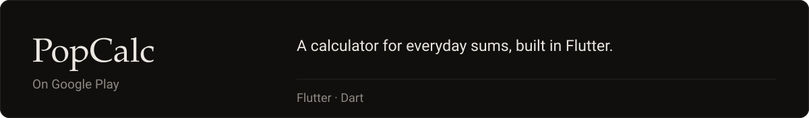
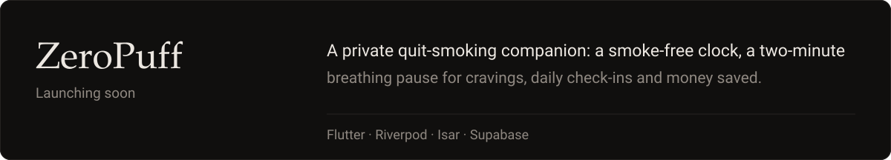
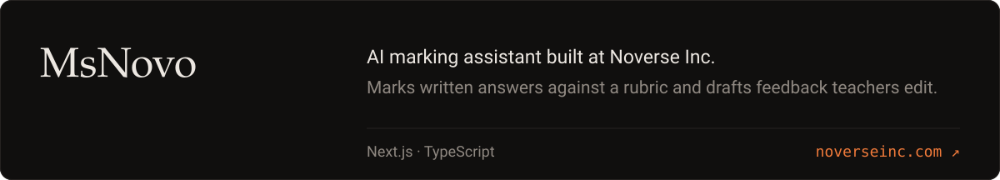
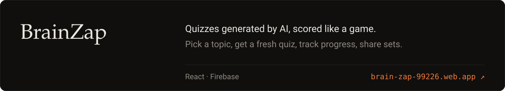
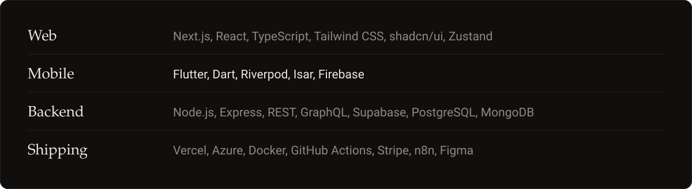
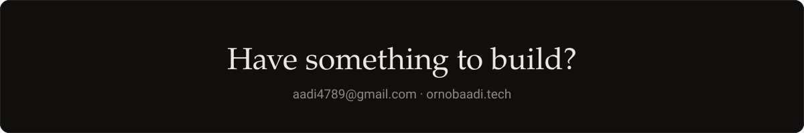

  &nbsp;
  &nbsp;
  &nbsp;
  &nbsp;
  

I spent about a year at Noverse Inc. shipping features for an AI learning platform. These days I build SaaS products end to end, from the interface down to the database, and Flutter apps for Android.

Source for these lives in my [repositories](https://github.com/ornobaadi?tab=repositories).

