<a href="https://www.ornobaadi.tech/">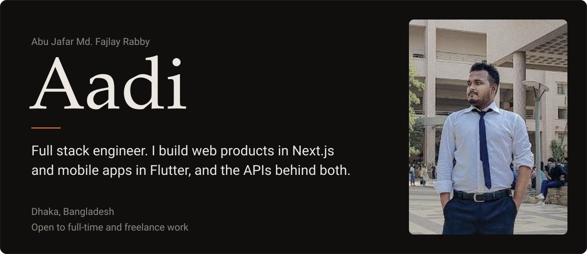</a>

  <a href="https://www.ornobaadi.tech/">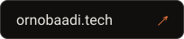</a>&nbsp;
  <a href="https://www.linkedin.com/in/ornobaadi/">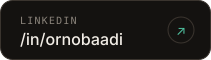</a>&nbsp;
  &nbsp;
  <a href="mailto:aadi4789@gmail.com">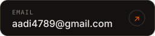</a>


<table>
  <tr>
    <td width="50%"><a href="https://play.google.com/store/apps/details?id=com.ornobaadi.popcalc">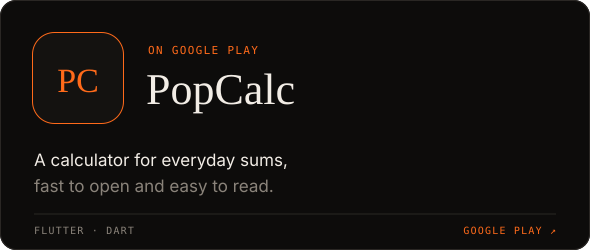</a></td>
    <td width="50%"></td>
  </tr>
</table>

<a href="https://noverseinc.com/"></a>
<a href="https://chatterbox-space.vercel.app/">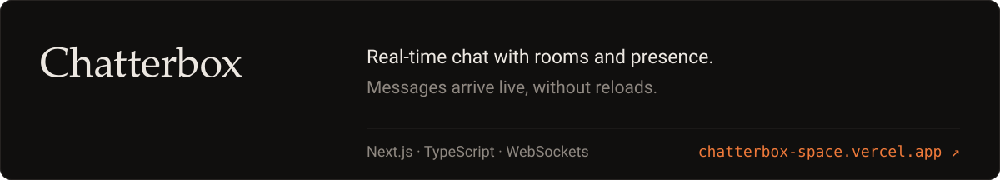</a>

<a href="https://skyy-scout.vercel.app/">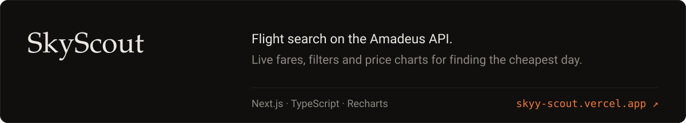</a>

<a href="https://brain-zap-99226.web.app/"></a>

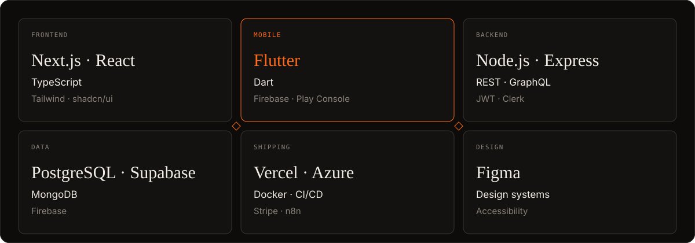

  &nbsp;
  &nbsp;
  

Prefer a quieter layout? See <a href="README-v2.md">v2</a>.

