<a href="https://www.ornobaadi.tech/">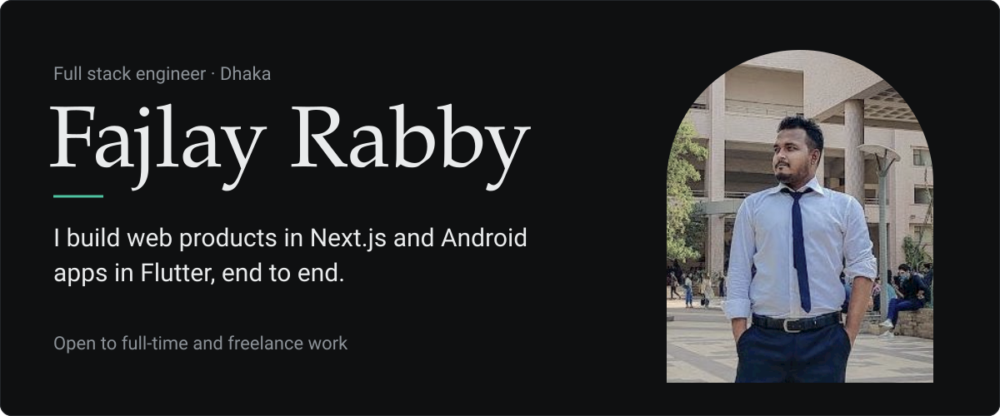</a>

  &nbsp;
  <a href="https://www.ornobaadi.tech/">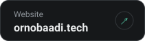</a>&nbsp;
  <a href="https://www.linkedin.com/in/ornobaadi/">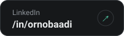</a>&nbsp;
  <a href="https://x.com/OrnobAadi">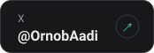</a>

I build web products in Next.js and Android apps in Flutter. Six apps on Google Play so far, and one of them is a calculator that jokes about your math.

<picture><source media="(prefers-color-scheme: light)" srcset="assets/m-title-apps-light.svg"></picture>

<table>
  <tr>
    <td width="50%"><a href="https://play.google.com/store/apps/details?id=com.ornobaadi.popcalc">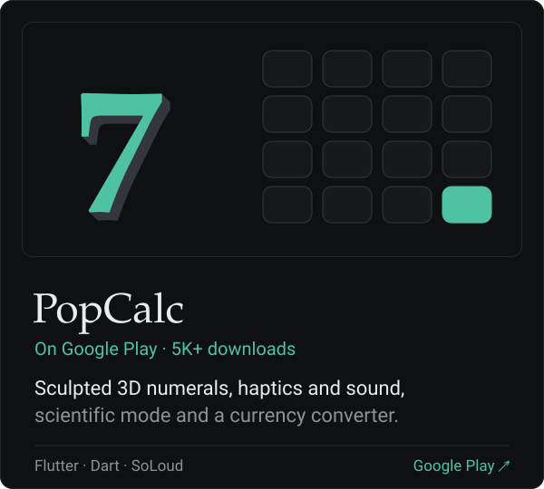</a></td>
    <td width="50%"><a href="https://play.google.com/store/apps/details?id=com.zeropuff.app">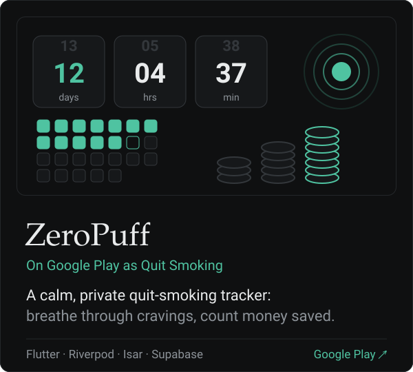</a></td>
  </tr>
  <tr>
    <td width="50%"><a href="https://play.google.com/store/apps/details?id=com.ornobaadi.ripped">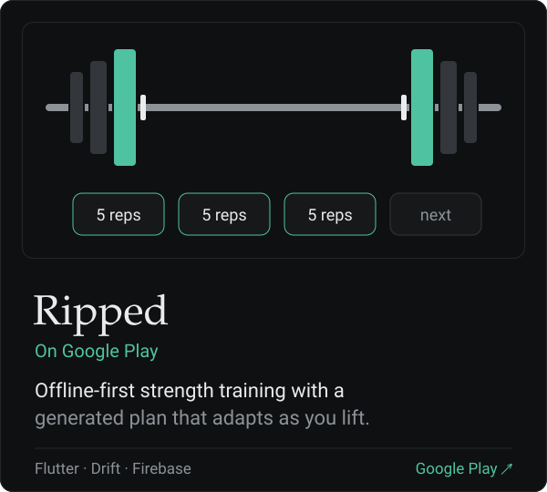</a></td>
    <td width="50%"><a href="https://play.google.com/store/apps/details?id=com.ornobaadi.twofold">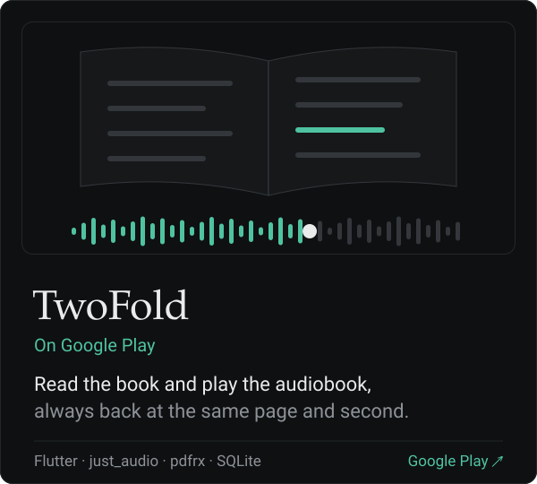</a></td>
  </tr>
  <tr>
    <td width="50%"><a href="https://play.google.com/store/apps/details?id=com.ornobaadi.waqt">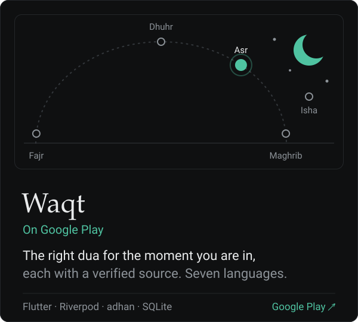</a></td>
    <td width="50%"><a href="https://play.google.com/store/apps/details?id=com.ornobaadi.suhbah">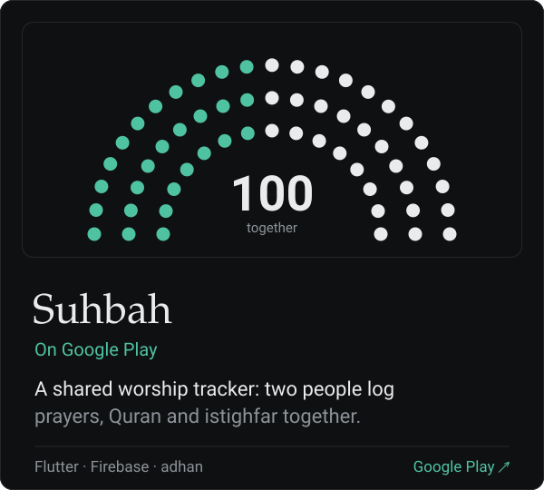</a></td>
  </tr>
</table>

<picture><source media="(prefers-color-scheme: light)" srcset="assets/m-title-work-light.svg"></picture>

<a href="https://noverseinc.com/">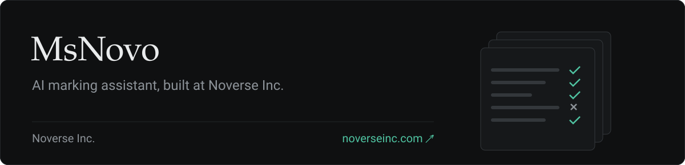</a>
<a href="https://chatterbox-space.vercel.app/">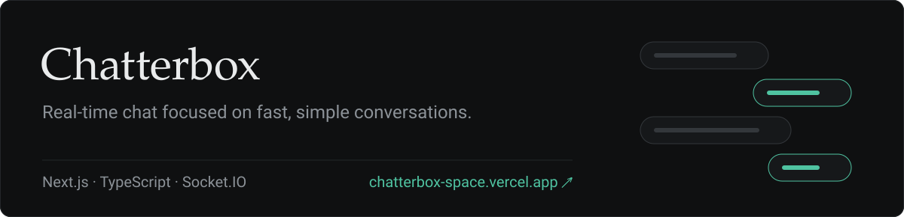</a>
<a href="https://skyy-scout.vercel.app/">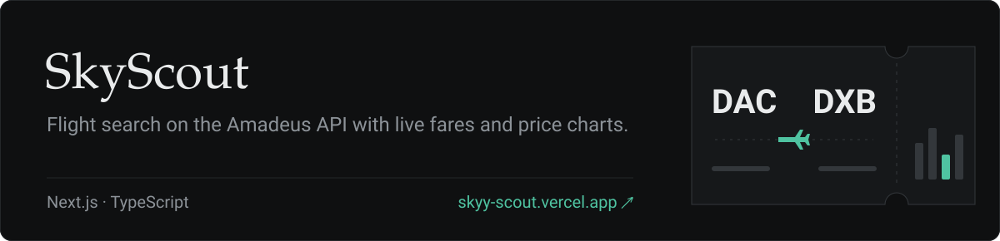</a>

<picture><source media="(prefers-color-scheme: light)" srcset="assets/m-title-toolkit-light.svg"></picture>

**Web** &nbsp;Next.js, React, TypeScript, Tailwind CSS, shadcn/ui, Zustand 
**Mobile** &nbsp;Flutter, Dart, Riverpod, Isar, Firebase 
**Backend** &nbsp;Node.js, Express, REST, GraphQL, Supabase, PostgreSQL, MongoDB 
**Shipping** &nbsp;Vercel, Azure, Docker, GitHub Actions, Stripe, n8n, Figma

<picture><source media="(prefers-color-scheme: light)" srcset="assets/m-title-activity-light.svg"></picture>

<a href="mailto:aadi4789@gmail.com">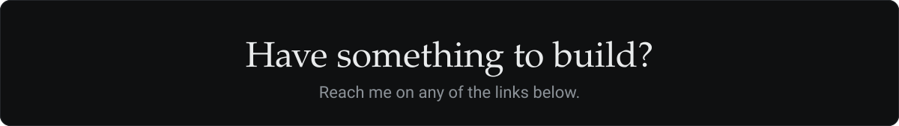</a>

  <a href="mailto:aadi4789@gmail.com">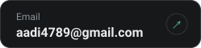</a>&nbsp;
  <a href="https://wa.me/8801974716063">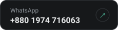</a>&nbsp;
  <a href="https://profile.ornobaadi.tech/">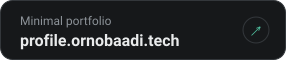</a>

